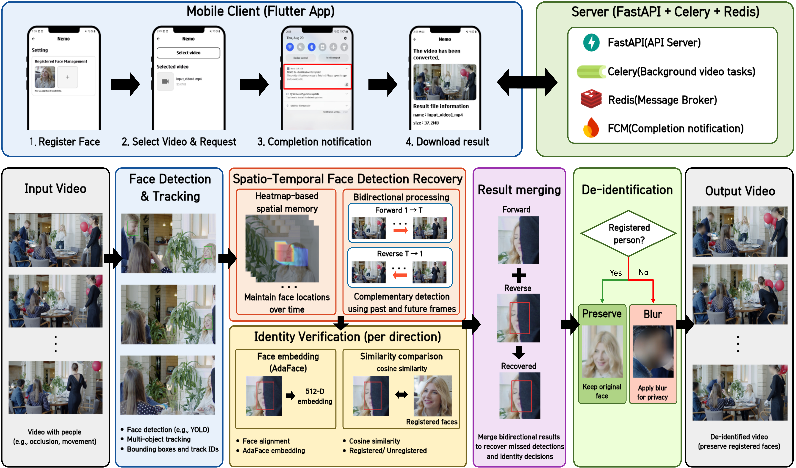
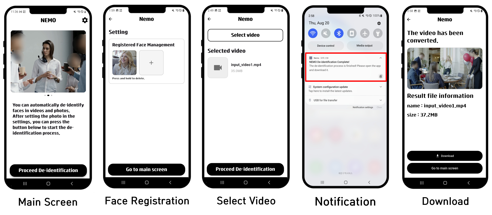

# Nemo Server

A Spatio-Temporal Face Detection Recovery Framework for Selective Video Face De-identification


## 1. Overview

This repository is the server and experiment code of **Nemo**, a mobile application that blurs the faces of third parties in a video while keeping the face of a registered user. It is the reference implementation of the paper on spatio-temporal face detection recovery for selective video face de-identification.

Frame-by-frame face detectors sometimes miss a face for a few frames (motion blur, partial occlusion, face turning away). In de-identification a missed face is left in the video as the original, so a short detection dropout becomes a privacy failure.

To reduce this, the framework combines three parts:

- **Heatmap spatial memory.** Each track ID keeps a decaying heatmap of where its face was seen. When the detector loses the face, a recovery box is created from the last reliable position and size. The box does not predict motion.
- **Forward and reverse processing.** The video is processed in both time directions, and the detections, recoveries and identity results of the two passes are merged.
- **Identity-based selective blur.** Detected faces are matched against registered face images (InsightFace alignment + AdaFace IR-50). Faces confirmed as the registered user stay as the original; every other face region, including recovered boxes, is blurred.

The face detector is replaceable. Besides YOLOv12s-face, the same recovery was also applied to YOLOv11n-face, YOLOv10n-face, SCRFD and YuNet.

Development period: 2025 - present (ongoing manuscript revision)

## 2. Repository Structure

```
Nemo-Server/
│
├── main.py                          # FastAPI app (upload, face registration, download)
├── celery_worker.py                 # Celery app (Redis broker/backend)
├── tasks_add_backTracking_V2.py     # Server pipeline: detection, recovery, identity, blur, FCM
├── heatmap_engine.py                # Heatmap spatial memory (shared by server and experiments)
├── core/net.py                      # AdaFace IR-50 model definition
├── requirements.txt
│
├── extract_coords_new.py            # Proposed method on YOLO: per-frame boxes by source
├── extract_coords_old.py            # YOLO baseline (single forward)
├── extract_coords_scrfd.py          # SCRFD baseline + proposed (ByteTrack)
├── extract_coords_yunet.py          # YuNet baseline + proposed (ByteTrack)
├── compare_all_V3.py                # Recall / Miss Rate / CovC / Exposed-Fr, hard frames
├── analyze_ablation.py              # Ablation (FwdHeat, RevDet, RevHeat, Full)
├── save_tracks.py                   # Save detection/tracking once for offline sweeps
├── sweep_heatmap.py                 # Heatmap hyperparameter sensitivity (one at a time)
│
├── measure_identity.py              # FRR / FAR_s on the registered-user labeled frames
├── identity_similarity.py           # Genuine / impostor similarity and threshold sweep
├── sample_frames.py                 # Frame sampling for labeling
├── label_video.py                   # Labeling helper
├── video_stats.py                   # Per-video statistics table
│
├── verify_heatmap_engine.py         # Compares the shared engine with saved results
└── find_good_frames.py, check_frame.py, crop_figure.py, make_figure_panels.py
                                     # Qualitative figure helpers

```

**Note on data and models.** Test videos, labels (`data/`), result folders (`results*/`), figure images (`*.png`), the YOLO weights (`models/*.pt`) and the AdaFace checkpoint are not all version controlled (see `.gitignore`). The service account key `serviceAccountKey.json` must never be committed. To reproduce the results, place the videos, labels and weights locally as described below.

## 3. How to Run

### Requirements

- Python 3.10+ (the code uses `dict | None` type syntax)
- PyTorch, torchvision, Ultralytics, OpenCV, NumPy
- FastAPI, Uvicorn, Celery, Redis, firebase-admin
- InsightFace, onnxruntime, pytorch-lightning (for identity verification)
- FFmpeg (H.264 re-encoding)
- A running Redis server on `localhost:6379`

```
pip install -r requirements.txt
pip install insightface onnxruntime pytorch-lightning
```

`requirements.txt` does not list the identity-verification packages above.

### Required files

| File | Used by |
|---|---|
| `models/yolov12s-face.pt` | detection (a pre-trained, publicly available face model is used without additional training) |
| `adaface_ir50_ms1mv2.ckpt` | AdaFace IR-50 embedding (loaded with `weights_only=False`) |
| `serviceAccountKey.json` | Firebase Cloud Messaging (server mode only) |

If `models/yolov12s-face.pt` cannot be loaded, the server code falls back to `models/yolov12n-face.pt`. Check the log to see which model was actually used.

### Local test (no server)

`tasks_add_backTracking_V2.py` has `LOCAL_TEST_MODE = True` by default. It processes `videos/video_03.mp4` with the faces in `data/video_03/registered_face` and writes `outputs/test3.mp4`.

```
python tasks_add_backTracking_V2.py
```

Set `LOCAL_TEST_MODE = False` before deploying the server.

### Server

```
redis-server
celery -A tasks_add_backTracking_V2 worker --loglevel=info
uvicorn main:app --host 0.0.0.0 --port 8000
```

| Endpoint | Role |
|---|---|
| `POST /upload` | Receive a video (`video`, `device_token`, `user_id`), queue the task, return `task_id` |
| `POST /upload_face` | Register a face image for a user |
| `DELETE /delete_face` | Delete a registered face image |
| `GET /file-info/{filename}` | Result file information |
| `GET /thumbnail/{filename}` | Result thumbnail |
| `GET /download/{filename}` | Download the result video |

When processing finishes, the server sends a completion notification through FCM.

### Experiments

Run in this order. Videos, labels and weights must be in place first.

```
python extract_coords_old.py   <model>     # baseline
python extract_coords_new.py   <model>     # proposed (YOLO)
python extract_coords_scrfd.py             # SCRFD
python extract_coords_yunet.py             # YuNet
python compare_all_V3.py                   # Recall / Miss Rate / CovC / Exposed-Fr
python analyze_ablation.py                 # ablation
python save_tracks.py ; python sweep_heatmap.py   # sensitivity analysis
python measure_identity.py                 # FRR / FAR_s
```

`run_remaining.ps1` runs the full set sequentially. Results are written under `results_reset/<model>/` and `results_sweep/<model>/`. Do not use the old `results/pooled_summary.csv`, which predates the ground-truth box fix.

## 4. Key Features

- **Heatmap spatial memory.** A per-ID heatmap on a grid at 10% of the frame size. Each frame the heatmap decays (λ = 0.96) and the face region is accumulated (β = 2.0, clipped at H_max = 10).
- **Spatial ID matching.** When the tracker outputs an ID that is not in memory, the existing heatmap with the highest response at the face center (> τ_H = 0.2) is used to link it to the old ID.
- **Detection recovery.** An ID that is not detected in the current frame gets a recovery box from its last reliable center and size (stored only when confidence ≥ τ_C = 0.45) while the heatmap maximum is ≥ τ_rec = 1.5. The memory is deleted at ≤ τ_del = 0.5. With these values the recovery lasts at most 46 frames, which is a theoretical upper bound.
- **Scene-change reset.** The memory is reset when the mean absolute difference of two consecutive frames (resized to 64×64) exceeds 30.
- **Bidirectional processing.** Forward and reverse results are merged by center proximity (ratio 0.8). Identity found in the reverse pass is propagated to the first matching forward box (no nearest or one-to-one matching).
- **Identity verification.** InsightFace alignment, AdaFace IR-50 embedding, cosine similarity > 0.35, confirmed after 3 cumulative matches per ID. Recovered boxes inherit the verdict of their ID. Unconfirmed IDs are blurred.
- **Selective blur.** A circular Gaussian blur (radius 0.6·max(w, h), kernel 121, σ = 50) on non-registered regions, re-encoded to H.264 with FFmpeg.

## 5. System Pipeline



Detection and tracking, heatmap-based recovery, and identity verification run separately in the forward and reverse passes; their results are then merged to decide the regions to blur. The video is processed asynchronously: FastAPI receives the request, a Celery worker (Redis broker) runs the pipeline, and the client is notified through FCM when the result is ready.

### Mobile App



The app manages registered faces, selects a video, requests de-identification, shows the completion notification, and downloads the result video.

## 6. Experimental Results

10 test videos, 4,359 labeled frames, 16,493 ground-truth faces. Matching is greedy one-to-one at IoU ≥ 0.3. Recall is the frame mean; Miss Rate is pooled over ground-truth faces. **Hard** frames are those where the detector's own single-forward baseline missed at least one face (n = 143, 449 and 709 for YOLOv12s, YOLOv11n and YOLOv10n). The hard sets differ across detectors, so the gains cannot be compared across detectors.

### Detection recovery (Recall, baseline → proposed)

| Detector | Hard frames | All frames |
|---|---|---|
| YOLOv12s-face | 0.738 → 0.906 | 0.991 → 0.997 |
| YOLOv11n-face | 0.742 → 0.930 | 0.973 → 0.993 |
| YOLOv10n-face | 0.718 → 0.964 | 0.954 → 0.994 |

Exposed-Fr (fraction of frames with at least one uncovered face, all frames): 3.3% → 1.2% (YOLOv12s), 10.3% → 3.1% (YOLOv11n), 16.3% → 2.6% (YOLOv10n).

These numbers come from the evaluation protocol (IoU-based deduplication of the four sources). They do not equal the exposure rate of the final rendered video, which also depends on identity and on center-proximity merging.

### Other detectors (Miss Rate, single forward → proposed, all frames)

| Detector | Miss Rate |
|---|---|
| SCRFD | 0.158 → 0.049 |
| YuNet | 0.176 → 0.083 |

SCRFD and YuNet use ByteTrack, while the YOLO experiments use BoT-SORT. Differences between detectors therefore cannot be attributed to the detector alone.

### Identity verification (registered-user labeled frames, at most 30 per video)

| | Count | Rate (Wilson 95% CI) |
|---|---|---|
| FRR (registered user blurred) | 3 / 262 | 1.15% (0.39 - 3.31) |
| FAR (unregistered accepted) | 0 / 771 | 0.00% (0.00 - 0.50) |
| Unregistered face without a de-identification region | 3 / 771 | 0.39% (0.13 - 1.14) |

The confidence intervals assume independent observations. Adjacent frames of the same person are included, so they should not be read as an upper bound for new people.

### Ablation and sensitivity

- Heatmap recovery contributes more than reverse detection alone. The Full configuration (forward and reverse detection plus heatmap recovery in both passes) gave the highest Recall and the lowest Exposed-Fr for all three detectors.
- Within the tested ranges, the recovery duration parameters (λ, τ_rec, H_max) changed the exposure metrics little (only λ = 0.90 was worse) but changed FP/frame clearly (0.35 - 1.93). The defaults were not tuned on these results.

## 7. Limitations and Future Work

### Limitations

- **Evaluation protocol vs. final rendering.** Detection recovery metrics are not measured on the final rendered video. Only the identity experiment applies the rendering rules, and only on the labeled registered-user frames.
- **Identity merging.** The reverse identity is passed to the first forward box that is close enough, without nearest or one-to-one matching. In crowded scenes the identity can move to a neighboring person, which can leave an unregistered face unblurred. Merge errors were not evaluated.
- **Recovery does not predict motion.** A recovery box keeps the last reliable position and size, so it can drift from the real face if the person moves quickly during a long dropout.
- **ID linking and scene-change detection** are not evaluated for accuracy.
- **Small dataset.** 10 videos with one registered user each. Consecutive frames are not independent samples.
- **No re-identification evaluation** after blur, and no evaluation of processing time or resource use.
- **Code caveats.** AdaFace is fed RGB crops, the checkpoint is loaded with `strict=False`, the audio track is not kept in the output, and a failed model load silently falls back to YOLOv12n. These are known and not yet addressed.

### Future Work

- Evaluate the final rendered video on all labeled frames (exposure, unregistered regions, FRR).
- Replace the identity merge with nearest or one-to-one matching, and hold the identity when the match is ambiguous.
- Compare with tracker-only baselines and measure processing time.
- Evaluate re-identification after blur and combination with generative de-identification.
